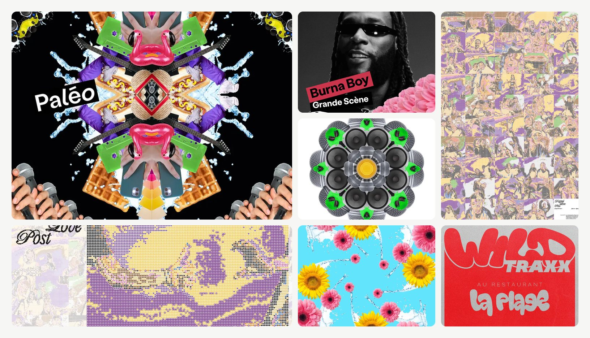

# Princess De La Cruz — Portfolio

Portfolio website of graphic designer **Princess De La Cruz**, live at **[princessdelacruz.ch](https://princessdelacruz.ch)**.



## Features

- **Minimal project index**: hover a project title to preview its key visual.
- **Bento-grid galleries**: projects with a gallery open a grid of mixed-size tiles: big, tall, wide or square.
- **Lightbox**: click any tile to view the full image or video, with swipe, arrow keys and looping.
- **Video tiles**: motion pieces play as muted loops, only while visible, and pause behind the lightbox. They stay still for visitors who prefer reduced motion.
- **Shareable gallery links**: each gallery has its own URL (e.g. [`#paleo-festival-nyon`](https://princessdelacruz.ch/#paleo-festival-nyon)), and the back button and Escape close it.
- **CV panel**: the header's CV button slides in a panel with the CV (experience and education).
- **Responsive**: 4-column grid on desktop and tablet, 2 columns on phones.

## Tech

A static site with no build step:

| | |
|---|---|
| Markup / styles | `index.html`, `css/princessdelacruz.css` (no CSS framework) |
| Interactivity | [Alpine.js](https://alpinejs.dev) 3.17.5, logic in `js/portfolio.js` |
| Lightbox | [GLightbox](https://biati-digital.github.io/glightbox/) 3.3.1, with [Plyr](https://plyr.io) 3.6.12 for video (loaded on demand) |
| Fonts | Syne (Google Fonts), TeX Gyre Heros (self-hosted) |
| Hosting | GitHub Pages, custom domain via `CNAME` |

All libraries load from jsDelivr, pinned to exact versions. Alpine and GLightbox also carry SRI integrity hashes.

## Run locally

Serve the repository root with any static server:

```sh
python3 -m http.server 8000
```

Then open <http://localhost:8000>, or <http://localhost:8000/#paleo-festival-nyon> to go straight to a gallery.

## Project structure

```
index.html                 page markup (project list + gallery template)
css/princessdelacruz.css   all styles
js/portfolio.js            project data (PROJECTS) + Alpine component
assets/
  fonts/  favicons/  logo/
  images/
    preview/               hover previews, one per project (WebP)
    gallery/<folder>/      gallery files, numbered in display order
      thumbs/              grid versions (+ video posters)
    archive/               full-resolution originals; not used by the page (git-ignored, local only)
```

## Adding or editing a project

Projects are defined in the `PROJECTS` array in `js/portfolio.js`:

```js
{
    title: 'PALEO FESTIVAL NYON', subtitle: 'VISUAL IDENTITY',
    image: '01-PFM.webp', size: '100%',        // hover preview (assets/images/preview/) and its height
    slug: 'paleo-festival-nyon',               // gallery URL: #paleo-festival-nyon
    gallery: {
        folder: '01-PALEO',                    // assets/images/gallery/01-PALEO/
        images: [
            { file: '01-affiche.webp', tile: 'big' },
            { file: '02-animation-affiche.mp4', tile: 'big' },
            { file: '03-photo-piscine-1.webp', tile: 'tall' },
            { file: '05-logo.webp', fit: 'contain' },
            // ...
        ],
    },
},
```

- `tile`: `big` (2×2), `tall` (1×2), `wide` (2×1), or omitted for a single square cell. On the 4-column grid, choose tiles so each row adds up to 4 columns. Any gaps are back-filled automatically, but a full grid looks best.
- `fit: 'contain'` shows the whole image with padding (useful for logos); `fit: 'whole'` shows the whole image or video without padding (useful for posters with text near the edges).
- Files ending in `.mp4` are treated as videos. Non-square videos need `ratio` (width / height, e.g. `ratio: 1080 / 1920`) so the lightbox sizes them correctly. Add `audio: true` to a video with sound: the lightbox then plays it unmuted with volume controls (grid tiles always stay muted).
- Gallery option `cellRatio` sets the shape of the grid cells (row height / column width, default `0.8`). For example, the DSIR gallery uses `1` for square cells that fit its square posts.
- Projects without `gallery` appear in the list, but they aren't clickable.

### Preparing media

Every gallery file needs a full-size version in `gallery/<folder>/` and a grid version with the same name in `gallery/<folder>/thumbs/`. Keep the originals in `archive/<folder>/`.

| | Full size (lightbox) | Grid (`thumbs/`) |
|---|---|---|
| Images | WebP, longest side ≤ 2400px | WebP, ≤ 1200px |
| Videos | H.264 MP4, 1080px, CRF 26, no audio | H.264 MP4, 720px, CRF 31 + a WebP poster frame |

Example with ffmpeg:

```sh
# Images
ffmpeg -i original.png -vf "scale='min(2400,iw)':'min(2400,ih)':force_original_aspect_ratio=decrease" -quality 84 01-name.webp
ffmpeg -i original.png -vf "scale='min(1200,iw)':'min(1200,ih)':force_original_aspect_ratio=decrease" -quality 76 thumbs/01-name.webp

# Videos (square source)
ffmpeg -i master.mov -vf scale=1080:1080:flags=lanczos -an -c:v libx264 -preset slow -crf 26 -pix_fmt yuv420p -movflags +faststart 02-name.mp4
ffmpeg -i master.mov -vf scale=720:720:flags=lanczos  -an -c:v libx264 -preset slow -crf 31 -pix_fmt yuv420p -movflags +faststart thumbs/02-name.mp4
ffmpeg -ss 1 -i 02-name.mp4 -frames:v 1 thumbs/02-name.webp
```

Footage with a transparent background (e.g. ProRes 4444) should be flattened onto a solid colour, because transparent video isn't supported in every browser:

```sh
ffmpeg -i master.mov -filter_complex "color=white:s=1080x1080:r=30[bg];[0:v]scale=1080:1080,format=rgba[fg];[bg][fg]overlay=shortest=1,format=yuv420p" -an -c:v libx264 -preset slow -crf 26 -movflags +faststart 15-name.mp4
```

The `archive/` folder is git-ignored: originals stay on your computer and are never published. GitHub rejects files over 100 MB.

## Credits

- Pool photos in the Paléo Festival Nyon gallery (`03-photo-piscine-1`, `13-photo-piscine-2`): **Yannis Antoine**.
- Clapping cat GIFs (`assets/easter-egg/`): [“Cat Clap” sticker](https://giphy.com/stickers/cat-meme-igreenscreenthings-kSoQQslyFDGiMvX5Df) (with handshake, used) and [“Cat Smile” sticker](https://giphy.com/stickers/cat-meme-clap-2neucQvRXgddx8K5rV) on GIPHY.

## Deployment

Pushing to `main` deploys the site with GitHub Pages. GitHub Pages lets browsers cache files for 10 minutes, so after a deploy, hard-refresh (Ctrl/Cmd + Shift + R) to see the changes straight away.
